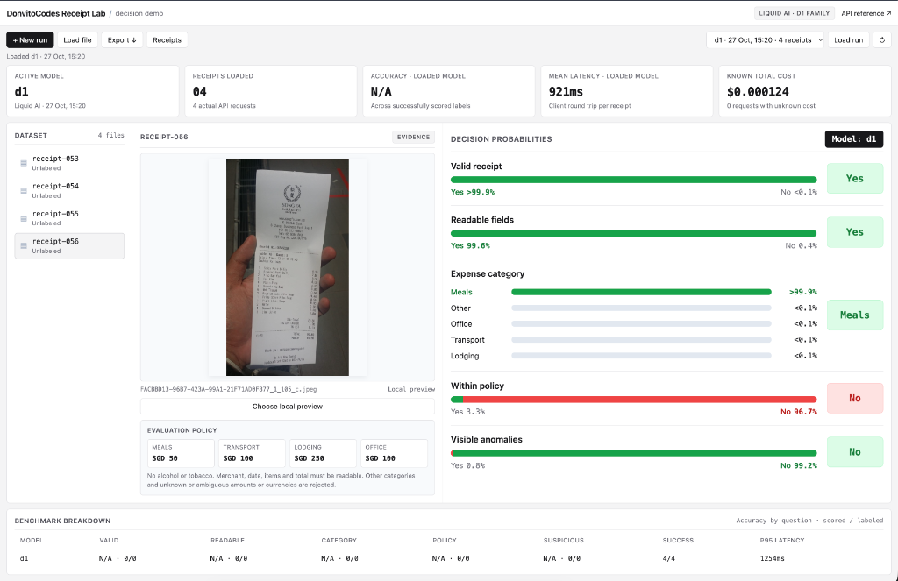

# DonvitoCodes Receipt Lab

Local UI and CLI for evaluating receipt images with Liquid AI decision models (`d1` and `d1-ultra`). Sends one receipt image + five typed questions per API call and returns structured probability distributions, latency, and token cost.



## Quick Start

```sh
bun install
bun run demo
```

Open the printed local URL (`http://127.0.0.1:3000` by default). Use `PORT=4317 bun run demo` for a custom port.

## Configuration

Set your Liquid AI API key in the environment or enter it directly in the **+ New run** modal:

```sh
export LIQUID_API_KEY="liquid_your_key"
```

- Each run uses **one model** (`d1` or `d1-ultra`) and saves a JSON report to `./results/`.
- Saved runs can be reloaded in the UI via **Load run** or **Load file** without an API key.

### CLI Usage

```sh
# Run against ./receipts/dataset.json
bun run bench --model d1
bun run bench --model d1-ultra

# Run against a custom dataset or save a copy to a specific path
bun run bench --model d1 --dataset sample/dataset.json --out report.json
```

Optional CLI flags: `--threshold 0.7` (default `0.5`), `--timeout-ms 20000` (default `30000`).

## Adding Receipts

Data is loaded relative to the working directory where you launch the app:

```text
receipts/
  dataset.json
  images/
    receipt-001.jpg
```

1. Place PNG, JPEG, or WebP images (up to 3 MB each) into `receipts/images/`.
2. Add an entry for each image in `receipts/dataset.json`:

```json
[
  {
    "id": "receipt-001",
    "image": "images/receipt-001.jpg",
    "labels": {}
  }
]
```

3. *(Optional)* Add ground-truth labels to compute accuracy:

```json
{
  "id": "receipt-001",
  "image": "images/receipt-001.jpg",
  "labels": {
    "valid": true,
    "readable": true,
    "category": "meals",
    "policy": true,
    "suspicious": false
  }
}
```

Supported categories: `meals`, `transport`, `lodging`, `office`, `other`. Restart the server after updating `receipts/dataset.json`.

## Evaluated Decisions

Each receipt is evaluated across 5 questions in a single `/decisions/v1/systemone` request:

- **`valid`** (`noul`): Purchase receipt with merchant, date, line items, and total.
- **`readable`** (`noul`): All required fields are clearly legible.
- **`category`** (`choice`): Primary category (`meals`, `transport`, `lodging`, `office`, `other`).
- **`policy`** (`noul`): Within reimbursement policy (SGD limits: Meals ≤ 50, Transport ≤ 100, Lodging ≤ 250, Office ≤ 100; no alcohol/tobacco).
- **`suspicious`** (`noul`): Visible alterations or arithmetic inconsistencies.
